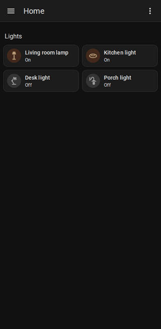

# Hold to Open for Home Assistant

[](https://hacs.xyz/docs/faq/custom_repositories)
[](https://github.com/kyler-frazier/hass-hold-to-open/releases)
[](https://github.com/kyler-frazier/hass-hold-to-open/actions/workflows/tests.yml)
[](LICENSE)

Home Assistant runs a card's **hold action** only when you lift your finger, so on a phone you
hold, guess when half a second has passed, and let go. This plugin runs the hold action **as soon
as the hold registers**, while your finger is still down, with a subtle "ghost" of the card to
acknowledge it.

It works with Home Assistant's own cards (tiles, buttons, entities and more), with no changes to
your dashboards.

<p align="center">
  
</p>

> [!NOTE]
> This plugin is **experimental**. It hooks into internal parts of the Home Assistant frontend
> that aren't a public API, so a future Home Assistant release could break it. It's built to fail
> safe: if those internals change, hold actions go back to Home Assistant's normal
> run-on-release behavior instead of misbehaving.

## Features

- **Hold actions run without releasing.** Opening an entity's details, running a script, or
  anything else you've set as a card's hold action.
- **No accidental taps.** Lifting your finger after a hold doesn't also count as a tap, so a
  light doesn't toggle when you only wanted its details.
- **The Back gesture still works.** Back closes the details that opened, instead of leaving the
  app.
- **Visual feedback.** A faint copy of the card swells and fades as the hold registers.
- **Adjustable hold time,** per dashboard.
- **Everything else is unchanged.** Taps, double taps, scrolling, cards without hold actions,
  dialogs and settings pages behave exactly as before.

## Installation

### HACS (recommended)

1. In HACS, open the menu (⋮) → **Custom repositories**.
2. Add `https://github.com/kyler-frazier/hass-hold-to-open` with the type **Dashboard**.
3. Search for **Hold to Open**, download it, and reload your browser or app.

### Manual

1. Download `hold-to-open.js` from the
   [latest release](https://github.com/kyler-frazier/hass-hold-to-open/releases/latest) into
   your `config/www/` folder.
2. Go to **Settings → Dashboards → ⋮ → Resources** and add `/local/hold-to-open.js` as a
   **JavaScript module**.

## Usage

Once installed it's active on every dashboard. Give a card a hold action as usual, for example:

```yaml
type: tile
entity: light.living_room
tap_action:
  action: toggle
hold_action:
  action: more-info
```

### Options

To change the behavior on a dashboard, open it, choose **⋮ → Edit dashboard → ⋮ → Raw
configuration editor**, and add a `hold_to_open` block at the top level. All options are optional.

| Option           | Default | Description                                                     |
| ---------------- | ------- | --------------------------------------------------------------- |
| `enable`         | `true`  | `false` restores Home Assistant's run-on-release behavior here. |
| `hold_time`      | `500`   | How long a press must last to count as a hold, in milliseconds. |
| `ghost`          | `true`  | Show the fading copy of the card when the hold registers.       |
| `ghost_opacity`  | `0.35`  | Starting opacity of the ghost, from 0 to 1.                     |
| `ghost_scale`    | `1.18`  | How much the ghost grows as it fades (1 = not at all).          |
| `ghost_duration` | `450`   | How long the ghost takes to fade, in milliseconds.              |

Example:

```yaml
hold_to_open:
  hold_time: 400
  ghost_opacity: 0.5
views:
  # ...
```

## Limitations

- **Touch screens only.** Mouse and trackpad holds keep Home Assistant's normal behavior.
- **Tested on Android.** iPhone and iPad feedback is very welcome.
- The ghost needs to copy the card. Some custom cards can't be copied; for those the ghost is
  skipped, and the hold action still runs.

## Contributing

Bug reports and pull requests are welcome. See [CONTRIBUTING.md](CONTRIBUTING.md) for how to run
the test suite against a throwaway Home Assistant instance.

## License

[MIT](LICENSE)
